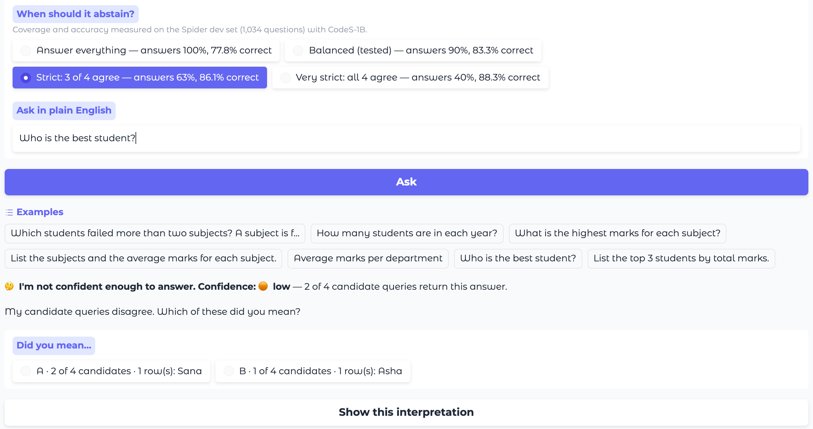

<h1 align="center">
  <picture>
    <source media="(prefers-color-scheme: dark)" srcset="desktop/assets/brand/logo-wordmark-dark.png">
    
  </picture>
</h1>

**A self-correcting natural-language-to-SQL interface that tells you when it isn't sure.**

Ask a database a question in plain English — *“Which students failed more than two subjects?”* —
and QueryGenie writes the SQL, runs it, and shows the result as a table and a chart. It runs
locally on open weights ([CodeS](https://arxiv.org/abs/2402.16347)), so by default no schema or data
leaves the machine. Unlike most text-to-SQL systems, it measures its own confidence: when its candidate
queries disagree, it asks *“Did you mean…?”* instead of returning a confident wrong answer.

Engineering Capstone Project (Phase I), Department of Computer Science & Information Technology,
Koneru Lakshmaiah Education Foundation (KL University). Team 18 — supervisor M Parameswar, Associate Professor.


## Results

All numbers are on the Spider development set (1,034 questions), scored with the official Spider
evaluator, using the released fine-tuned CodeS-1B checkpoint.

| | Questions answered | Execution accuracy on answered |
|---|---|---|
| CodeS-1B, as reported in the paper | 100% | 77.9% |
| **CodeS-1B, reproduced here** | 100% | **77.8%** |
| **+ confidence-aware abstention** (tested setting) | 90.4% | **83.3%** |

- **Reproduction:** within 0.1 points of the paper. Getting there required an audit of our own
  evaluation harness, which found a scoring mismatch and a value-retriever bug
  ([`results/harness_audit.md`](results/harness_audit.md)).
- **Enhancement:** wrong answers fall from 230 to 156 (−32%). The gain is significant under a paired
  t-test (p = 7.7 × 10⁻¹⁰), a Wilcoxon signed-rank test (p = 9.8 × 10⁻⁴) and a question-level
  bootstrap (95% CI +4.5 to +6.7 points)
  ([`results/week12_comparative_results.md`](results/week12_comparative_results.md)).
- **Ablation:** every part of the CodeS prompt contributes 0.9–1.9 points; the value retriever
  matters most ([`results/week7_ablation_study.md`](results/week7_ablation_study.md)).
- **Not yet measured:** Test-suite accuracy (the paper reports 72.2%) — TBD.

## Run the app

QueryGenie is a desktop app for macOS and Windows (a native window, not a web page).

```bash
python3 -m venv .venv && source .venv/bin/activate
pip install -r requirements.txt
python desktop/main.py
```

On first start a setup assistant checks the computer and downloads the model
(`seeklhy/codes-1b-spider`, about 4.5 GB) and, optionally, the 20 Spider development databases
(about 0.2 GB) from Hugging Face. Everything is stored in your user folder
(`~/Library/Application Support/QueryGenie`, or `%APPDATA%\QueryGenie` on Windows), not in the app.
To build a double-clickable app instead, see [`desktop/build.md`](desktop/build.md).

In the app:

- **Databases** (left): a small academic database, the 20 Spider databases the 77.8% / 83.3% figures
  were measured on, any **SQLite file** you add, and live **PostgreSQL / MySQL** connections.
  Everything runs read-only.
- **Chats** (middle): *New chat* (⌘N / Ctrl+N) starts a thread; keep asking in it. Follow-ups use the last
  few questions as context (Settings → General: up to 10, or *all that fit* the model's context window, which
  is asked from Ollama, Claude and Gemini; *New topic* starts fresh). Chat models get the earlier questions as
  real conversation turns with the SQL that answered them, and — for models on this computer, or if you allow
  it for cloud services — the first rows each returned. CodeS models get no context: they were trained on single questions,
  and gluing or rewriting follow-ups made them answer the wrong question, so with CodeS every question is
  answered on its own (the *Context* switch beside the model picker is off) and the pipeline runs as measured.
- **Chat view**: every answer shows how many of the 4 candidate queries agree, the table, a chart,
  the SQL (editable) and all four candidates. When they disagree it asks *"I'm not sure which you
  mean"* and shows the readings instead of guessing.
- **Map view**: the whole database as a tree (tables, columns, keys, links). Tap a table or column
  for ready-made questions, or to use its name in your question.
- **Self-correction:** a candidate query that fails is sent back once with its error and replaced by the repair
  (Settings → General). Measured on Spider with CodeS-1B it changes little — 61 of 377 failed queries ran after
  repair, one more answer was right (77.76% → 77.85%; [`results/repair_eval.md`](results/repair_eval.md)) — since
  CodeS was not trained on error feedback; the reported figures are without it.
- **Model picker** under the question box: switch model, and set its effort where the provider has one
  (Claude low → max; OpenAI-style reasoning models low / medium / high; Ollama thinking on / off).
- **Settings → Model**: the evaluated CodeS-1B-Spider (the default, and the only model whose accuracy
  was measured); the earlier prototype's CodeS models (MLX 4-bit, GGUF 2-bit, base CodeS — from source
  only); any model in **Ollama**; your own CodeS-format model or any **OpenAI-compatible server**
  (LM Studio, vLLM…); and cloud services — **OpenAI, Anthropic (Claude), Google (Gemini), xAI (Grok)**,
  DeepSeek, Mistral, Groq, OpenRouter and Together. Every model gets the same four-candidate
  confidence check, labelled "not calibrated" for anything but CodeS-1B. Cloud services receive the
  schema, a few example values and the question (never result rows), after a confirmation; API keys
  are kept in the macOS Keychain / Windows Credential Manager.
- **Settings → when to decline**: answer everything (100% / 77.8%), balanced (90% / 83.3%),
  strict (63% / 86.1%), very strict (40% / 88.3%) — coverage and accuracy measured on Spider dev.



### Connect your own database

**Add database → Connect to PostgreSQL or MySQL**, then enter host, database, user and password.
QueryGenie reads the schema, builds a value index once, and answers on the live database:

- the model's SQLite-style SQL is translated to the server's dialect (sqlglot) and shown next to
  the original;
- only a single read-only query is accepted, run inside a **READ ONLY transaction** with a
  30-second timeout and a 1,000-row limit — use a read-only database user anyway;
- the password is kept in memory only.

On Spider's databases loaded into PostgreSQL, translated queries return the same answer as on
SQLite for 94.4% of gold queries and 93.7% of model predictions
([`results/postgres_translation_check.md`](results/postgres_translation_check.md)). Accuracy and
confidence were calibrated on SQLite; on other engines they are not yet measured.

### The earlier web prototype

The Gradio prototype shown at Reviews 1–2, with the experimental MLX / GGUF / base-CodeS backends,
is kept in [`legacy/`](legacy/) and still runs: `python legacy/app.py` (then open
http://127.0.0.1:7860). It uses the same evaluated core as the desktop app.

## Reproduce the results

**1. Reproduction and the candidate record (GPU, about 1 hour).** Open
[`research/reproduction/notebooks/02_tier2_colab_eval.ipynb`](research/reproduction/notebooks/02_tier2_colab_eval.ipynb) in Google Colab with a
T4 GPU runtime and run the Week-10 cell. It runs
[`research/reproduction/colab_eval_tier2.py`](research/reproduction/colab_eval_tier2.py), which downloads Spider and the model
from Hugging Face, evaluates all 1,034 questions with the official evaluator, and saves
`preds_<run>.txt` and `dump_<run>.jsonl` (all 4 candidates per question). Ablations are set with
`QG_ABLATE` (`no_values`, `no_content`, `no_fk`, `no_select`); another model with `QG_MODEL`.

**2. Enhancement analysis (CPU, seconds).**

```bash
python research/enhancement/abstention.py results/dump_T2-006.jsonl
```

This reproduces the significance tests, the operating points and the accuracy–coverage figure
from the committed candidate record.

**3. Tests (no model needed).** `python -m pytest tests/ -q` (45 tests)

**4. Dataset provenance.** `python scripts/download_spider.py` fetches Spider from Hugging Face
(`xlangai/spider`) and records its provenance in `results/dataset_provenance.json`.

Every run — including superseded ones — is logged with seed, hardware, runtime and library versions
in [`results/reproduction_log.csv`](results/reproduction_log.csv) and
`results/Reproduction_Log.xlsx`.

### Deviations from the authors' setup

Inference-only reproduction with the released checkpoint (the authors' pre-training used 8 × A800
GPUs). Newer PyTorch / transformers than the pinned versions; a scan of all column values instead of
the authors' Lucene BM25 index before their (unchanged) value matcher; no schema item classifier;
Tesla T4 with the same fp16 precision and batch size as the authors' inference. Details and their
effects: final report, Section 6.

## Repository layout

```
querygenie/           the core — what the app runs, and what was evaluated
  pipeline.py         the evaluated CodeS pipeline: prompt, 4 candidates, selection, agreement
  model.py            CodesSFTBackend: fine-tuned CodeS with scored beam candidates
  confidence.py       strictness modes, measured operating points, answer-or-abstain
  databases.py        catalogue: sample, Spider dev, added files, live connections; schema map
  connectors.py       live PostgreSQL / MySQL: schema, value index, SQL translation, read-only execution
  sample_db.py        builds the small academic database
  vendor/             authors' CodeS utilities, unmodified (Apache-2.0)
desktop/              the desktop app: native window (pywebview), interface (ui/), first-run setup,
                      packaging (QueryGenie.spec, build.md)
research/             how the numbers were produced
  reproduction/       the Colab harness (colab_eval_tier2.py), local evaluation, score_dump.py, dataset analysis, notebooks/
  enhancement/        abstention.py (tests, bootstrap, operating points), agreement_v2.py, selection and repair analyses
  reality/            Spider-Realistic and BIRD evaluations (benchmark-to-reality gap)
  app-checks/         PostgreSQL translation check, "unclear question" check, demo rehearsal
legacy/               Gradio web prototype (Reviews 1–2) and its MLX / GGUF / base-CodeS backends
scripts/              setup: Spider dataset and database download, PostgreSQL loader, Mac setup
  docs/               builders for the Review-3 deck and speaker script
  poster/             builders for the project poster (charts + pptx)
results/              run log, audit, ablation, abstention results, figures, candidate record
tests/                model-free tests: selection, agreement, abstention, databases, chats
docs/                 everything written, sorted by purpose:
  weekly-reports/     Week 1-14: each week's report and the document that was due that week
  reviews/            Review-1, Review-2, Review-3 (one folder each; Review-3 is the Review-III pack)
  poster/             the project poster (pptx + print PDF) and its assets
  figures/            pipeline / architecture diagrams and app screenshots
  report-latex/       the LaTeX project report (source + PDF)
  Templates/          the department's templates (reference posters kept locally only)
  reference/          department SOP and Phase-I guidelines
  DELIVERABLES.md     the live tracker: every SOP week -> artefact -> status
```

### Where files moved (30 September 2026)

Documents written before this date (weekly reports, reproducibility reports v1–v2, the Review 2
deck, `results/`) cite the old paths. The code is unchanged apart from imports.

| Old path | New path |
|---|---|
| `src/codes_prompt.py` | `querygenie/pipeline.py` |
| `src/model.py` | `querygenie/model.py` (evaluated backend) + `legacy/models.py` (other backends) |
| `src/engine.py` | `querygenie/confidence.py` (abstention) + `legacy/self_correct.py` (retry loop) |
| `src/databases.py`, `src/connectors.py`, `src/vendor/` | `querygenie/` (same names) |
| `src/build_sample_db.py` | `querygenie/sample_db.py` |
| `src/app.py`, `src/charts.py`, `src/database.py` | `legacy/` (same names) |
| `src/abstention.py` | `research/enhancement/abstention.py` |
| `src/eval_spider_full.py` | `research/reproduction/eval_spider_full.py` |
| `src/eval_spider.py` | `research/reproduction/eval_spider_v1.py` |
| `scripts/colab_eval_tier2.py`, `scripts/smoke_test.py` | `research/reproduction/` (same names) |
| `scripts/check_postgres_translation.py` | `research/app-checks/check_postgres_translation.py` |
| `scripts/convert_mlx.py` | `legacy/scripts/convert_mlx.py` |
| `notebooks/` | `research/reproduction/notebooks/` |

### Where files moved (14 October 2026)

Documents submitted earlier (the printed project report, the run log `results/reproduction_log.csv`) still
cite the old paths below.

| Old path | New path |
|---|---|
| `research/{colab_eval_tier2,eval_spider_full,eval_spider_v1,smoke_test,score_dump,dataset_analysis}.py`, `research/notebooks/` | `research/reproduction/` |
| `research/{abstention,agreement_v2,selection_analysis,repair_eval}.py` | `research/enhancement/` |
| `research/{reality_eval,reality_analysis,bird_eval}.py` | `research/reality/` |
| `research/{check_postgres_translation,check_unclear,demo_check}.py` | `research/app-checks/` |
| `scripts/{build_review3_deck,build_speaker_script}.py` | `scripts/docs/` |
| `scripts/{build_poster,poster_charts}.py` | `scripts/poster/` |
| `docs/Review-III/` (report, deck, speaker and demo scripts) | `docs/reviews/Review-3/` |
| `docs/Review-III/{QueryGenie_Poster.pptx,.pdf,poster_assets/}` | `docs/poster/` (`assets/`) |
| `docs/reviews/Review1_QueryGenie.docx`, `Week1_Shortlist_Feasibility_Matrix.docx` | `docs/reviews/Review-1/` |
| `docs/reviews/Review2_QueryGenie.pptx`, `docs/Code_Reproducibility_Report_v1.docx` | `docs/reviews/Review-2/` |
| `docs/reviews/Review3_QueryGenie.pptx` (earlier deck) | `docs/reviews/Review-3/earlier-draft/` |
| `docs/Code_Reproducibility_Report_v2.docx` | `docs/weekly-reports/Week 8/` |
| `docs/Enhancement_Proposal_Week9.docx` | `docs/weekly-reports/Week 9/` |
| `docs/Week12_Comparative_Results.docx` | `docs/weekly-reports/Week 12/` |
| `docs/Final_Report_Draft.docx` | `docs/weekly-reports/Week 14/` |
| `docs/CodeS_Annotated_Paper.pdf` | `docs/weekly-reports/Week 3/` |
| `docs/{architecture,final_pipeline,codes_architecture_flowchart}.*`, `docs/screenshots/` | `docs/figures/` |

## Documents

| Document | File |
|---|---|
| Project report (LaTeX, department template) | [`docs/report-latex/main.pdf`](docs/report-latex/main.pdf) — source in [`docs/report-latex/`](docs/report-latex/) |
| Final report (draft) | [`docs/weekly-reports/Week 14/Final_Report_Draft.docx`](docs/weekly-reports/Week%2014/Final_Report_Draft.docx) |
| Code reproducibility report v2 | [`docs/weekly-reports/Week 8/Code_Reproducibility_Report_v2.docx`](docs/weekly-reports/Week%208/Code_Reproducibility_Report_v2.docx) |
| Enhancement proposal (Week 9) | [`docs/weekly-reports/Week 9/Enhancement_Proposal_Week9.docx`](docs/weekly-reports/Week%209/Enhancement_Proposal_Week9.docx) |
| Comparative results (Week 12) | [`docs/weekly-reports/Week 12/Week12_Comparative_Results.docx`](docs/weekly-reports/Week%2012/Week12_Comparative_Results.docx) |
| Annotated CodeS paper (Week 3) | [`docs/weekly-reports/Week 3/CodeS_Annotated_Paper.pdf`](docs/weekly-reports/Week%203/CodeS_Annotated_Paper.pdf) |
| Deliverables tracker | [`docs/DELIVERABLES.md`](docs/DELIVERABLES.md) |
| Weekly status reports | [`docs/weekly-reports/`](docs/weekly-reports/) |

## Papers

| Role | Paper | arXiv |
|---|---|---|
| Anchor (reproduced) | CodeS: Towards Building Open-source Language Models for Text-to-SQL (SIGMOD 2024) | [2402.16347](https://arxiv.org/abs/2402.16347) |
| Benchmark | Spider (EMNLP 2018) | [1809.08887](https://arxiv.org/abs/1809.08887) |
| Evaluation | Semantic Evaluation for Text-to-SQL with Distilled Test Suites (EMNLP 2020) | [2010.02840](https://arxiv.org/abs/2010.02840) |
| Self-correction (app feature) | DIN-SQL (NeurIPS 2023) | [2304.11015](https://arxiv.org/abs/2304.11015) |
| Abstention | Selective Classification for Deep Neural Networks (NeurIPS 2017) | [1705.08500](https://arxiv.org/abs/1705.08500) |
| Candidate agreement | Self-Consistency Improves Chain of Thought Reasoning in Language Models (ICLR 2023) | [2203.11171](https://arxiv.org/abs/2203.11171) |
| Charts | LIDA (ACL 2023) | [2303.02927](https://arxiv.org/abs/2303.02927) |

## Team

- N V V S S Jayakanth Kamisetti — 2320090050
- Boddupally Narendar — 2320090009
- M Praneeth Reddy — 2320090018
- Supervisor: M Parameswar

## Licence

Apache License 2.0 — see [`LICENSE`](LICENSE) and [`NOTICE`](NOTICE). The files in `querygenie/vendor/` are
from [RUCKBReasoning/codes](https://github.com/RUCKBReasoning/codes) (Apache-2.0), unmodified.
Model weights and the Spider dataset are downloaded under their own licences and are not included.
