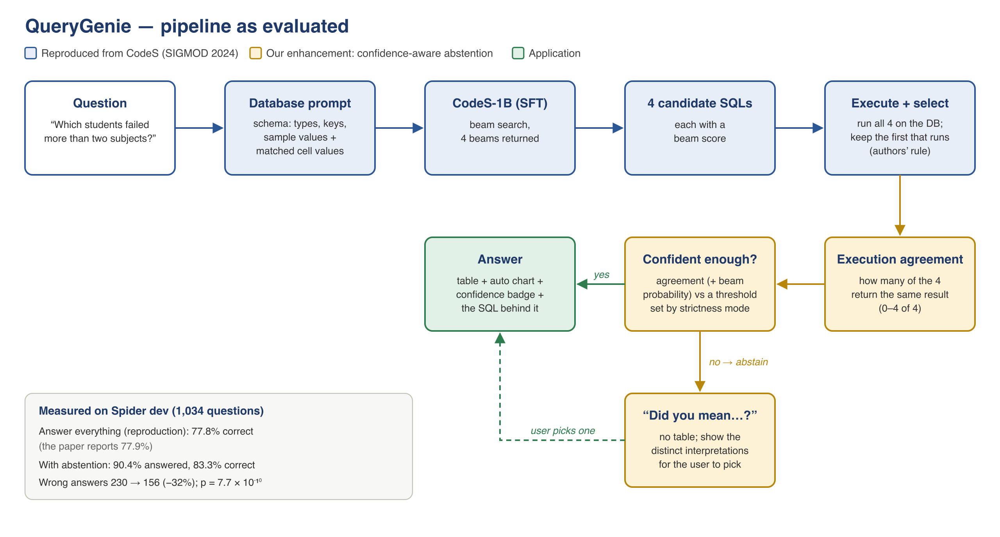

# QueryGenie

**A self-correcting natural-language-to-SQL interface that tells you when it isn't sure.**

Ask a database a question in plain English — *“Which students failed more than two subjects?”* —
and QueryGenie writes the SQL, runs it, and shows the result as a table and a chart. It runs
locally on open weights ([CodeS](https://arxiv.org/abs/2402.16347)), so no schema or data leaves the
machine. Unlike most text-to-SQL systems, it measures its own confidence: when its candidate
queries disagree, it asks *“Did you mean…?”* instead of returning a confident wrong answer.

Engineering Capstone Project (Phase I), Department of Computer Science & Information Technology,
Koneru Lakshmaiah Education Foundation (KL University). Team 21 — supervisor M Parameswar.



## Results

All numbers are on the Spider development set (1,034 questions), scored with the official Spider
evaluator, using the released fine-tuned CodeS-1B checkpoint.

| | Questions answered | Execution accuracy on answered |
|---|---|---|
| CodeS-1B, as reported in the paper | 100% | 77.9% |
| **CodeS-1B, reproduced here** | 100% | **77.8%** |
| **+ confidence-aware abstention** (tested setting) | 90.4% | **83.3%** |

- **Reproduction:** within 0.1 points of the paper. Getting there required an audit of our own
  evaluation harness, which found a scoring mismatch and a value-retriever bug
  ([`results/harness_audit.md`](results/harness_audit.md)).
- **Enhancement:** wrong answers fall from 230 to 156 (−32%). The gain is significant under a paired
  t-test (p = 7.7 × 10⁻¹⁰), a Wilcoxon signed-rank test (p = 9.8 × 10⁻⁴) and a question-level
  bootstrap (95% CI +4.5 to +6.7 points)
  ([`results/week12_comparative_results.md`](results/week12_comparative_results.md)).
- **Ablation:** every part of the CodeS prompt contributes 0.9–1.9 points; the value retriever
  matters most ([`results/week7_ablation_study.md`](results/week7_ablation_study.md)).
- **Not yet measured:** Test-suite accuracy (the paper reports 72.2%) — TBD.

## Run the app

```bash
python3 -m venv .venv && source .venv/bin/activate
pip install -r requirements.txt
python src/app.py            # then open http://127.0.0.1:7860
```

**Databases.** The app ships with a small academic database. For the 20 Spider development
databases — concerts, pets, world countries, flights, museums and more, each with real example
questions — run `python scripts/download_spider_dbs.py` once (downloads from Hugging Face). These
are the databases the 77.8% / 83.3% figures were measured on. You can also **upload your own SQLite
file** from the sidebar. All queries run on a read-only connection.

The first question downloads `seeklhy/codes-1b-spider` (about 4.5 GB) and takes a little longer;
after that each question takes a few seconds on an Apple M-series Mac or a GPU. A bundled academic
database is created on first start. Stop the app with `Ctrl+C`.

In the app:

- **Model** — *evaluated pipeline + confidence* runs exactly the setup measured above (1B or 3B).
  The optional MLX and GGUF models (below) are faster but report no confidence.
- **When should it abstain?** — four settings, each showing its measured coverage and accuracy:
  answer everything (100% / 77.8%), balanced (90% / 83.3%), strict (63% / 86.1%), very strict
  (40% / 88.3%).
- Every answer shows a confidence badge (how many of the 4 candidate queries agree) and the SQL
  behind the table. When the candidates disagree, the alternative interpretations are listed.


UI development without downloading a model: `QUERYGENIE_BACKEND=mock python src/app.py`.

### Optional: faster local models on Apple Silicon

```bash
pip install -r requirements-apple.txt           # see the file for the llama.cpp build flag
python scripts/convert_mlx.py 3b --variant spider   # CodeS-3B-Spider, 4-bit MLX
huggingface-cli download tensorblock/seeklhy_codes-7b-spider-GGUF \
    codes-7b-spider-Q2_K.gguf --local-dir gguf_models   # CodeS-7B-Spider, 2-bit GGUF
```

## Reproduce the results

**1. Reproduction and the candidate record (GPU, about 1 hour).** Open
[`notebooks/02_tier2_colab_eval.ipynb`](notebooks/02_tier2_colab_eval.ipynb) in Google Colab with a
T4 GPU runtime and run the Week-10 cell. It runs
[`scripts/colab_eval_tier2.py`](scripts/colab_eval_tier2.py), which downloads Spider and the model
from Hugging Face, evaluates all 1,034 questions with the official evaluator, and saves
`preds_<run>.txt` and `dump_<run>.jsonl` (all 4 candidates per question). Ablations are set with
`QG_ABLATE` (`no_values`, `no_content`, `no_fk`, `no_select`); another model with `QG_MODEL`.

**2. Enhancement analysis (CPU, seconds).**

```bash
python src/abstention.py results/dump_T2-006.jsonl
```

This reproduces the significance tests, the operating points and the accuracy–coverage figure
from the committed candidate record.

**3. Tests (no model needed).** `python -m pytest tests/ -q` (11 tests)

**4. Dataset provenance.** `python scripts/download_spider.py` fetches Spider from Hugging Face
(`xlangai/spider`) and records its provenance in `results/dataset_provenance.json`.

Every run — including superseded ones — is logged with seed, hardware, runtime and library versions
in [`results/reproduction_log.csv`](results/reproduction_log.csv) and
`results/Reproduction_Log.xlsx`.

### Deviations from the authors' setup

Inference-only reproduction with the released checkpoint (the authors' pre-training used 8 × A800
GPUs). Newer PyTorch / transformers than the pinned versions; a scan of all column values instead of
the authors' Lucene BM25 index before their (unchanged) value matcher; no schema item classifier;
Tesla T4 with the same fp16 precision and batch size as the authors' inference. Details and their
effects: final report, Section 6.

## Repository layout

```
src/
  app.py              Gradio web app (confidence badge, "Did you mean…?", strictness modes)
  codes_prompt.py     The evaluated CodeS pipeline: prompt, candidates, selection, agreement
  engine.py           Answer/abstain logic and the simple generate→execute→self-correct loop
  model.py            Model backends: evaluated pipeline, transformers, MLX, GGUF, mock
  abstention.py       Week-11 analysis: tests, bootstrap, operating points, figure
  databases.py        database catalogue: sample, Spider dev databases, uploads (read-only)
  database.py, charts.py, build_sample_db.py   schema helpers, auto chart, sample database
  eval_spider_full.py local (simple-metric) variant of the evaluation
  eval_spider.py      legacy harness that produced run T2-001
  vendor/             authors' CodeS utilities, unmodified (Apache-2.0)
scripts/              Colab evaluation harness, Spider dataset + database download, MLX conversion, Week-4 smoke test
notebooks/            Week-4 gate notebook; Colab notebook for all Tier-2 runs
results/              run log, audit, ablation, abstention results, figures, candidate record
tests/                model-free tests of selection, agreement and abstention
docs/                 reports (final report, reproducibility report, proposal), weekly reports,
                      department SOP and templates, diagrams
```

## Documents

| Document | File |
|---|---|
| Final report (draft) | [`docs/Final_Report_Draft.docx`](docs/Final_Report_Draft.docx) |
| Code reproducibility report v2 | [`docs/Code_Reproducibility_Report_v2.docx`](docs/Code_Reproducibility_Report_v2.docx) |
| Enhancement proposal (Week 9) | [`docs/Enhancement_Proposal_Week9.docx`](docs/Enhancement_Proposal_Week9.docx) |
| Comparative results (Week 12) | [`docs/Week12_Comparative_Results.docx`](docs/Week12_Comparative_Results.docx) |
| Annotated CodeS paper (Week 3) | [`docs/CodeS_Annotated_Paper.pdf`](docs/CodeS_Annotated_Paper.pdf) |
| Deliverables tracker | [`docs/DELIVERABLES.md`](docs/DELIVERABLES.md) |
| Weekly status reports | [`docs/weekly-reports/`](docs/weekly-reports/) |

## Papers

| Role | Paper | arXiv |
|---|---|---|
| Anchor (reproduced) | CodeS: Towards Building Open-source Language Models for Text-to-SQL (SIGMOD 2024) | [2402.16347](https://arxiv.org/abs/2402.16347) |
| Benchmark | Spider (EMNLP 2018) | [1809.08887](https://arxiv.org/abs/1809.08887) |
| Evaluation | Semantic Evaluation for Text-to-SQL with Distilled Test Suites (EMNLP 2020) | [2010.02840](https://arxiv.org/abs/2010.02840) |
| Self-correction (app feature) | DIN-SQL (NeurIPS 2023) | [2304.11015](https://arxiv.org/abs/2304.11015) |
| Abstention | Selective Classification for Deep Neural Networks (NeurIPS 2017) | [1705.08500](https://arxiv.org/abs/1705.08500) |
| Candidate agreement | Self-Consistency Improves Chain of Thought Reasoning in Language Models (ICLR 2023) | [2203.11171](https://arxiv.org/abs/2203.11171) |
| Charts | LIDA (ACL 2023) | [2303.02927](https://arxiv.org/abs/2303.02927) |

## Team

- N V V S S Jayakanth Kamisetti — 2320090050
- Boddupally Narendar — 2320090009
- M Praneeth Reddy — 2320090018
- Supervisor: M Parameswar

## Licence

Apache License 2.0 — see [`LICENSE`](LICENSE) and [`NOTICE`](NOTICE). The files in `src/vendor/` are
from [RUCKBReasoning/codes](https://github.com/RUCKBReasoning/codes) (Apache-2.0), unmodified.
Model weights and the Spider dataset are downloaded under their own licences and are not included.
